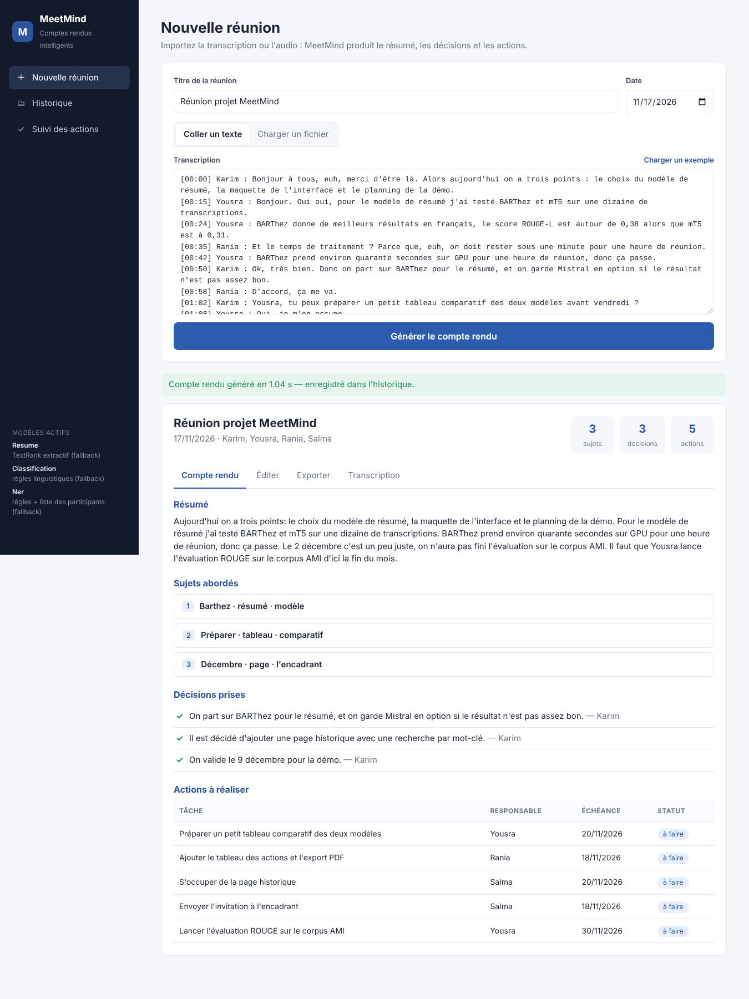
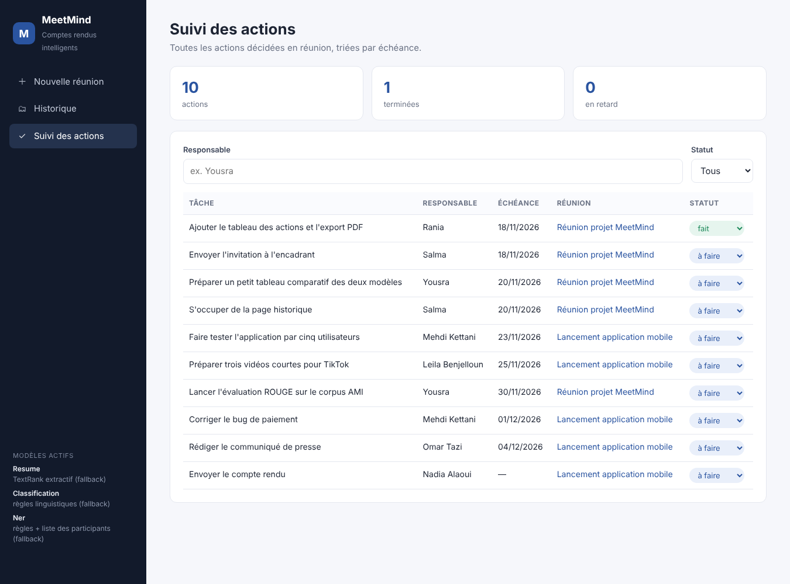

# MeetMind — Assistant intelligent de comptes rendus de réunion

**Yousra Erraki** · Projet NLP · EMSI 2026-2027

MeetMind transforme automatiquement une réunion (texte, fichier ou audio) en **compte rendu structuré** :

- résumé global et sujets abordés,
- décisions prises,
- actions à réaliser (tâche · responsable · échéance).

La réunion peut être en **français**, en **anglais** ou en **darija**.



## Fonctionnalités

- **Entrées acceptées** :
  - texte collé ;
  - fichiers `.txt`, `.docx`, `.pdf` ;
  - sous-titres Teams/Zoom (`.vtt` / `.srt`) ;
  - audio `.mp3` / `.wav` ;
  - enregistrement direct au micro dans le navigateur.
- **Pipeline NLP en 6 étapes**. Le résumé, les décisions et les actions sont calculés en parallèle.
- **Dates résolues** : « vendredi », « d'ici la fin du mois », darija « ghedda » ou « 9bel jem3a » deviennent de vraies dates.
- **Historique** avec recherche, édition du compte rendu, et suivi des actions (à faire / en cours / fait).
- **Export** en PDF, Word ou texte, et **envoi par e-mail** aux participants (SMTP).
- **Tout tourne en local**. Les données de réunion ne quittent pas la machine.



## Stack technique

| Couche | Technologies |
|---|---|
| Backend | Python, FastAPI, SQLAlchemy, PostgreSQL (SQLite en développement) |
| Frontend | React (Vite), servi par nginx ; prototype Streamlit |
| NLP | Hugging Face Transformers, PyTorch, spaCy, Sentence-BERT, scikit-learn |
| Déploiement | Docker, Docker Compose |

| Tâche NLP | Modèle | Solution de secours |
|---|---|---|
| Speech-to-text | **Whisper** (small) avec vocabulaire du domaine | — |
| Résumé abstractif | **BARThez** (orangesum) | TextRank extractif |
| Classification des phrases (décision / action / information) | **CamemBERT fine-tuné** | TF-IDF + régression logistique, puis règles |
| Responsables et échéances | **spaCy** (entités PER) + règles de dates FR/darija | liste des participants |
| Segmentation thématique | **Sentence-BERT** + clustering contigu | TF-IDF + TextTiling |

## Architecture

```
Entrée (React)      texte · fichier · audio · micro
      │
1. Transcription    Whisper (+ diarisation pyannote, optionnelle)
2. Prétraitement    nettoyage, locuteurs, segmentation en sujets
      ├──────────────────┬──────────────────┐   en parallèle
3a. Résumé          3b. Décisions       3c. Actions + NER
      └──────────────────┴──────────────────┘
4. Compte rendu     fusion en un document structuré
5. Stockage         PostgreSQL
6. Export           PDF · Word · e-mail
```

## Résultats

Évaluation sur 5 réunions de test, jamais vues pendant le développement :

| Configuration | ROUGE-L résumé | F1 décisions | F1 actions |
|---|---|---|---|
| Règles seules + TextRank | **0,357** | 0,53 | 0,32 |
| TF-IDF + règles | **0,357** | 0,65 | 0,49 |
| **CamemBERT fine-tuné + BARThez** (configuration finale) | 0,247 | **0,76** | **0,80** |

- CamemBERT au niveau des phrases : **F1 décision 0,82**, **F1 action 0,90**.
- Quand une action est trouvée, son responsable est correct dans **100 %** des cas et son échéance dans **~93 %**.
- BARThez rédige des résumés plus naturels, mais il a été entraîné sur de la presse et ne connaît pas la darija. Pour maximiser ROUGE, il faut utiliser `SUMMARIZER=extractive`.

Analyse détaillée : [`evaluation/RESULTATS.md`](evaluation/RESULTATS.md).

## Démarrage rapide (Docker)

```bash
git clone https://github.com/yousraerraki/meetmind.git
cd meetmind
cp .env.example .env          # puis remplir SMTP_* pour l'envoi d'e-mails
docker compose up --build
```

- Interface : http://localhost:8080
- API (Swagger) : http://localhost:8000/docs

Pour avoir les vrais modèles (Whisper, BARThez, spaCy, Sentence-BERT ; image d'environ 2,5 Go) :

```bash
INSTALL_NLP=true docker compose up --build
# PowerShell : $env:INSTALL_NLP="true"; docker compose up --build
```

Sans ces modèles, l'application fonctionne quand même avec les solutions de secours.

### CamemBERT fine-tuné

Le modèle entraîné n'est pas versionné, car il est trop volumineux. Pour l'obtenir :

1. Ouvrir [`notebooks/MeetMind_CamemBERT_autonome.ipynb`](notebooks/MeetMind_CamemBERT_autonome.ipynb) dans Google Colab (GPU T4).
2. Tout exécuter.
3. Décompresser le modèle produit dans `models/camembert-meetmind/`. L'API le charge automatiquement.

## Développement local

```bash
python -m venv .venv && source .venv/bin/activate     # Windows : .venv\Scripts\activate
pip install -r requirements.txt                       # + requirements-nlp.txt pour les modèles
uvicorn backend.app.main:app --reload                 # API      → :8000
cd frontend-react && npm install && npm run dev       # React    → :5173
pytest -q                                             # tests
```

## API

| Méthode | Route | Rôle |
|---|---|---|
| POST | `/meetings/analyze` | texte / fichier / audio → compte rendu |
| GET | `/meetings?q=` | historique et recherche |
| GET · PUT · DELETE | `/meetings/{id}` | consulter / corriger / supprimer |
| GET | `/meetings/{id}/export/{pdf\|docx\|txt}` | export |
| POST | `/meetings/{id}/email` | envoi aux participants |
| GET · PATCH | `/actions`, `/actions/{id}` | suivi des actions |
| GET | `/health` | modèles actifs |

## Arborescence

```
backend/app/       API FastAPI · base de données
  nlp/             transcription · diarisation · prétraitement · résumé · classification · NER · pipeline
  export/          PDF, Word, e-mail
frontend-react/    interface React
frontend/          prototype Streamlit
notebooks/         fine-tuning CamemBERT (Colab)
training/          entraînement TF-IDF et CamemBERT
evaluation/        scripts et résultats (ROUGE, F1)
data/              corpus annoté (train / test) et réunions d'exemple
tests/             tests du pipeline et de l'API
```

## Données

Le corpus a été rédigé pour le projet : il est synthétique.
- **Entraînement** : 10 réunions, plus 285 phrases annotées à la main (FR / EN / darija).
- **Test** : 5 réunions séparées. Chacune a un résumé, des décisions et des actions de référence.

## Limites et pistes

- Le corpus est petit et synthétique. L'étape suivante est d'annoter des réunions réelles.
- Les transcriptions de test sont parfaites. Il faut encore mesurer l'impact des erreurs de Whisper.
- Le résumé de la darija reste faible avec BARThez. Un LLM local (Mistral via Ollama, profil `llm`) est déjà disponible en option.
